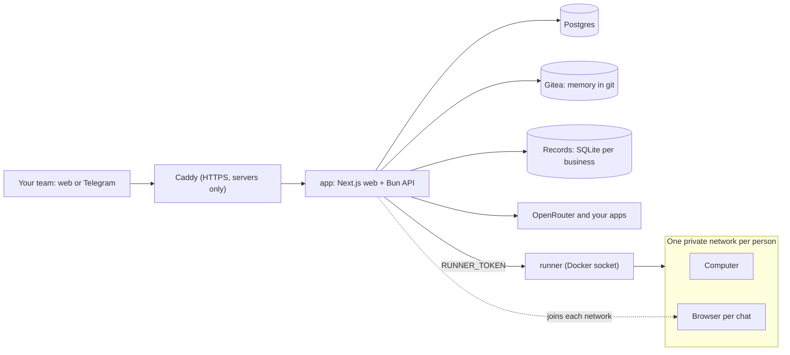

Emplio is a few Docker services on one machine. The app does the thinking and holds the rules; the runner is the only part that can start containers.

## App

One container runs the web app (Next.js, in `frontend/`) on port 3000 and the API (Bun and Fastify, in `backend/`) on port 4000. The API runs the chat, the `emplio` commands, apps, approvals and every background job. It talks to the AI models through OpenRouter.

## Postgres

Accounts, businesses, chats, tasks, automations, connections, saved logins and the activity log. The schema is in `backend/src/db/schema.ts`, with Drizzle migrations in `backend/drizzle/`.

## Gitea for memory

Each business is a Gitea organization with a `company` repo, a `restricted` repo for admins, and one `me-<userId>` repo per person. The API is Gitea's only client. Computers never reach Gitea: commits travel as git bundles through the API, so the git credential never enters a computer.

## Runner, computers and browsers

`runner/runner.ts` is the only process with the Docker socket. It starts containers from Emplio's two images only, with fixed limits, never privileged and never with a folder from the machine. Each person gets their own network holding their computer and their browsers. Those networks can't reach Postgres, Gitea or the runner. A computer sleeps when idle and keeps its files; a browser is Chromium, one per chat.

## Records

Each business's records database is its own SQLite file in `app-data`, which Emplio queries with `emplio db`.

## Background work

The API runs check-ins, the morning brief, the end-of-day report and task reminders (`heartbeat.ts`), Emplio's own tasks when they fall due (`tasks.ts`), scheduled and triggered automations (`automations.ts`), and hand-offs to agents, each a thread of its own (`jobs.ts`).

<Columns cols={2}>
  <Card title="Project map" icon="folder-tree" href="/developers/project-map">
    Where each part lives in the repo.
  </Card>
  <Card title="Build from source" icon="hammer" href="/developers/build-from-source">
    Run your own changes.
  </Card>
</Columns>
